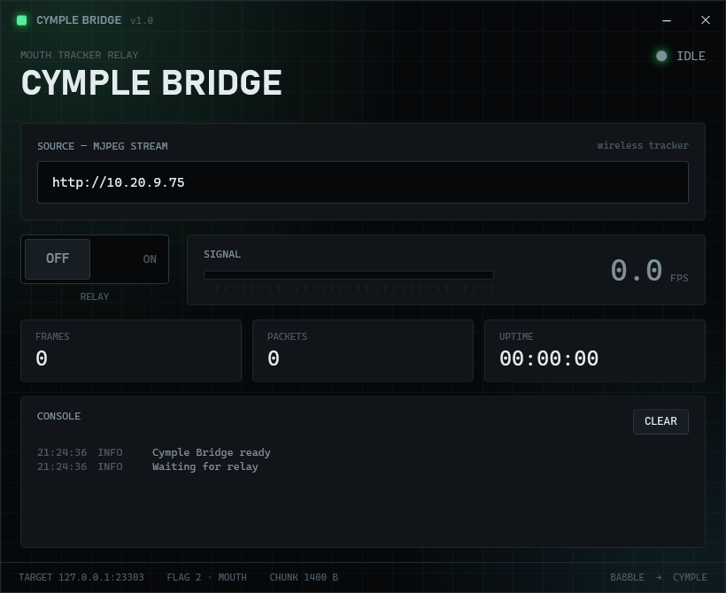
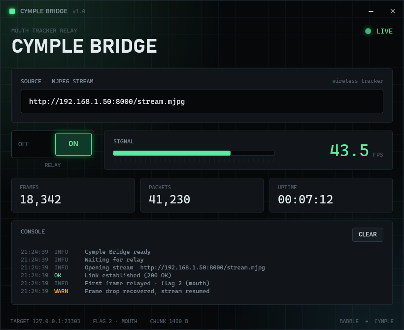
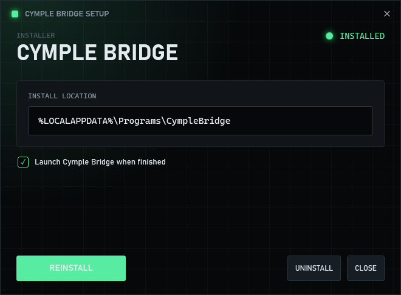
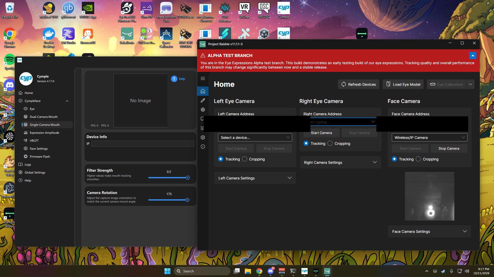
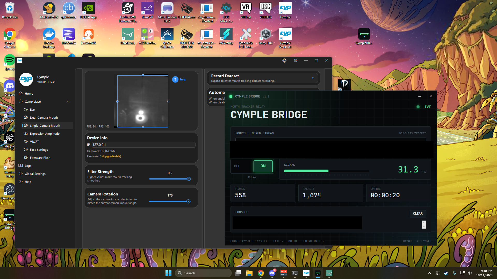

# Cymple Bridge

Relays a wireless, Babble-compatible mouth tracker into the **Cymple** desktop app as if it
were a native Cymple mouth device. Your Cymple eye trackers keep working as they are; this fills
in the mouth.

The tracker streams MJPEG over Wi-Fi. Cymple Bridge reads that stream, scales each frame, and
re-emits it as a Cymple `MSG_IMAGE_V2` packet on `127.0.0.1:23303` with device flag `2` (mouth).
Cymple then runs its own mouth model on it — no firmware changes to the tracker.

> Unofficial community tool. Not affiliated with Cymple or Project Babble.

## Download

**[Download the latest installer →](../../releases/latest)**

Grab `CympleBridgeSetup.exe`, run it, done. Self-contained: no .NET install required.

## Screenshots







In context — Cymple eye cameras and the mouth tracker running alongside Cymple Bridge:





## Features

- Paste the tracker's MJPEG URL and flip one relay switch.
- Live state (`IDLE → LINKING → LIVE`), FPS meter, frame/packet counters, uptime, and a console log.
- Automatic reconnect when the stream drops.
- **Tray mode**: the close button hides to the tray and keeps the relay running; the minimize
  button minimizes to the taskbar. Tray right-click gives **Open** / **Close**.
- Remembers the URL and window position.
- Themed installer with one-click uninstall (also listed in Add/Remove Programs).

## Requirements

- Windows 10 or 11, 64-bit.
- A wireless Babble-compatible mouth tracker exposing an MJPEG stream, e.g.
  `http://192.168.1.50:8000/stream.mjpg`.
- Cymple desktop app with the mouth function enabled (`[Function Switch] cymple_mouth_sw = true`
  in `iniFile.ini`).

## Use

1. Find the tracker's stream URL and confirm it plays in a browser.
2. Launch Cymple Bridge and paste the URL.
3. Flip **RELAY** to ON.
4. Start the Cymple desktop app with mouth tracking enabled.

## How it works

Cymple devices speak a simple image transport: each camera frame is sent to the desktop app as a
`MSG_IMAGE_V2` TLV over UDP, split into chunks. Cymple Bridge impersonates a mouth device on that
transport. The full packet layout is documented in [docs/PROTOCOL.md](docs/PROTOCOL.md).

## Build from source

Requires the [.NET 10 SDK](https://dotnet.microsoft.com/download).

```powershell
git clone https://github.com/<you>/cymple-bridge.git
cd cymple-bridge
./scripts/build-release.ps1
```

This publishes the app, packs it into the installer payload, and writes
`dist/CympleBridgeSetup.exe`. To produce a release, tag it and let CI attach the installer:

```powershell
git tag v1.0.0
git push origin v1.0.0
```

## Project layout

```
src/CympleBridge/         Desktop app (WPF): relay, tray, settings
  Bridge/BridgeRunner.cs  MJPEG read + resize + UDP emit
  Bridge/CymplePackets.cs Cymple MSG_IMAGE_V2 packet builder
  Bridge/JpegFramer.cs    SOI/EOI frame splitter
  Bridge/Uninstaller.cs   shortuts + registry + folder removal
src/CympleBridgeSetup/    Themed installer / uninstaller
tests/gui_e2e.py          End-to-end harness (fake camera -> packet sniffer)
scripts/build-release.ps1 One-shot build
docs/PROTOCOL.md          Cymple image transport reference
```

## Testing

`tests/gui_e2e.py` serves a fake MJPEG camera, runs the built app headlessly, and reassembles the
Cymple packets it sends:

```powershell
dotnet build src/CympleBridge -c Release
python tests/gui_e2e.py
```

## License

[MIT](LICENSE).
